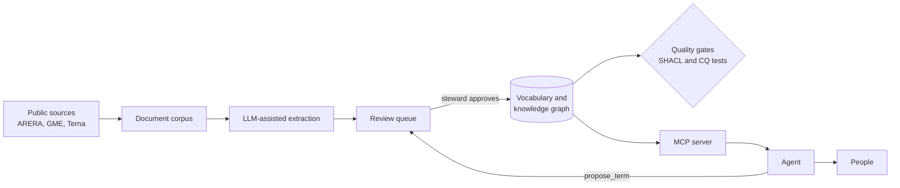

# Architecture

The same architecture serves the public version and any internal deployment: here it runs on public sources, in a company it would run on internal documents and processes.

## Components

| Component | Technology | Status |
| --- | --- | --- |
| Vocabulary and ontology | SKOS and OWL in Turtle, versioned in git | v0.1 in progress |
| Quality gates | SHACL (pySHACL), competency questions as SPARQL, pytest, GitHub Actions | Available |
| MCP server | MCP Python SDK, over the vocabulary | Preview |
| Review queue | JSON Lines file plus the term proposal issue template | Preview |
| Document corpus and extraction | Python, an LLM through its API, human review | v0.2 |
| Knowledge graph store | RDF in git first; a triple store such as Oxigraph when the graph outgrows it | v0.2 |
| Agent | Any MCP client, such as Claude Desktop or Claude Code | Demo |
| Evaluation | Test cases on the competency questions, accuracy and human correction rate | Demo, v0.9 |

## Design choices

- **Files in git before a database.** Every change to the vocabulary is a reviewable, reversible commit. A store arrives only when queries need it.
- **Competency questions are tests.** Each question has a SPARQL query in `evals/cq/`. Once the vocabulary answers it, it goes into the enforced list and CI keeps it answered.
- **Governance is executable.** SHACL shapes in `ontology/shapes.ttl` check labels, status, source and steward on every commit.
- **The agent proposes, people decide.** The MCP server can read the vocabulary but cannot change it: new terms go to a review queue.
